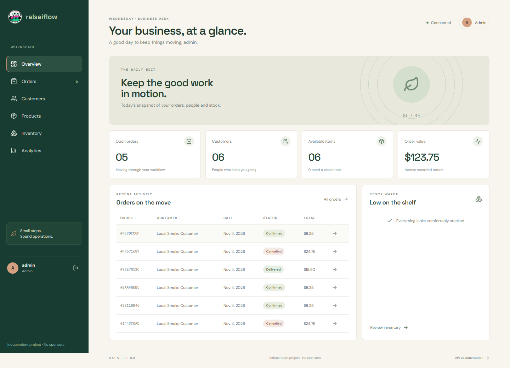
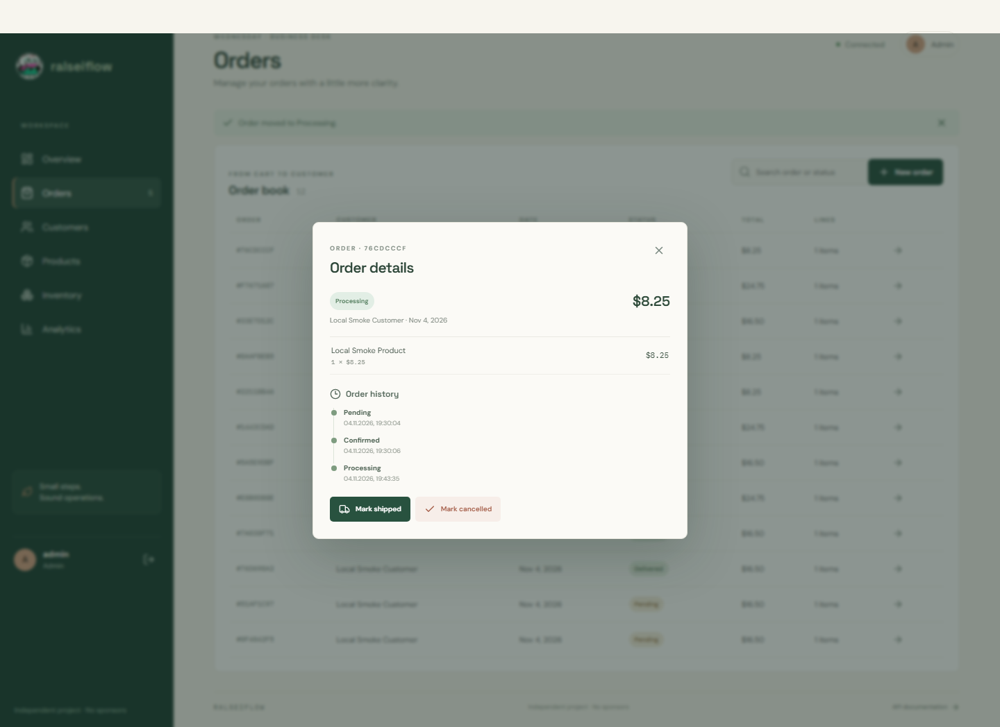
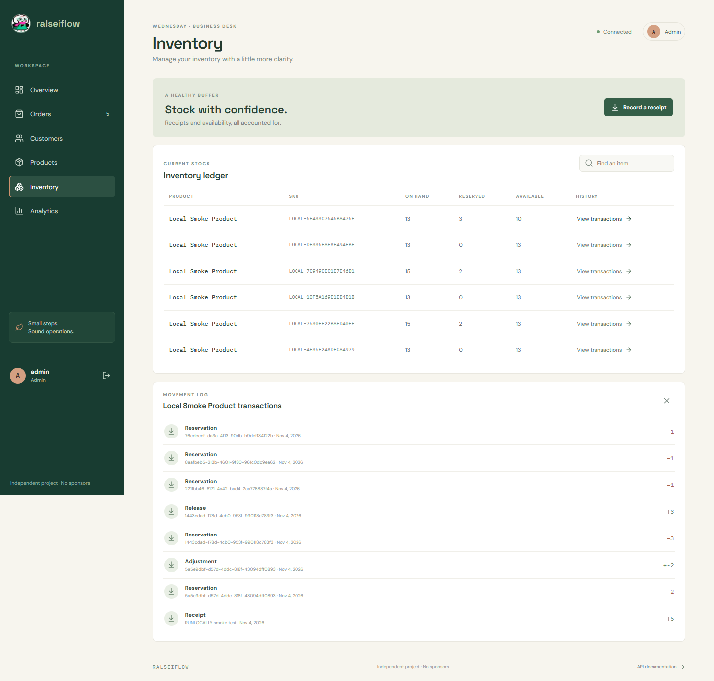
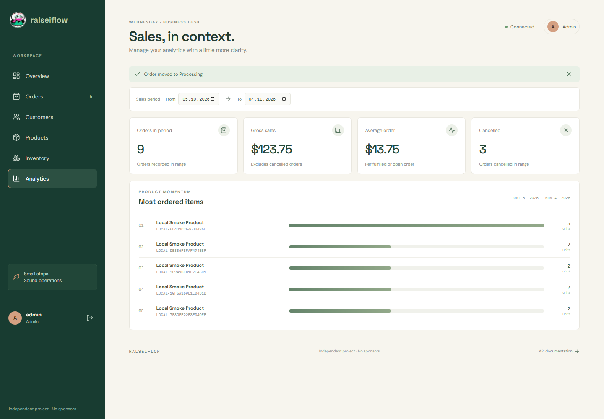

# RalseiFlow

**Orders, stock & business — in one place.**

RalseiFlow is an independent full-stack order and inventory management application. It brings customers, products, orders, stock movements, and sales information into one workspace so a small business can follow everyday operations in context.

## What it does

- Keeps customer and product records organized.
- Creates and manages orders with prices calculated from saved product data.
- Tracks order status changes and history.
- Reserves stock for orders and releases it when orders are cancelled; records fulfillment movements.
- Records stock receipts and provides an inventory transaction history.
- Summarizes sales and orders with date filters.
- Provides Admin and Employee access roles.
- Includes a REST API and PostgreSQL storage, with local Docker Compose deployment.

## Screenshots

*Dashboard — a quick view of orders, customers, available stock, and recent activity.*

*Order management — order details, current status, and recorded lifecycle history.*

*Inventory — on-hand, reserved, and available quantities alongside stock movements.*

*Analytics — order and sales summaries for a selected period.*

## Technology

C# and .NET 10, ASP.NET Core, Entity Framework Core, PostgreSQL, React, TypeScript, Vite, JWT authentication, role-based authorization, Docker Compose, FluentValidation, Serilog, Swagger, and xUnit.

## Project status

This is a completed, independently developed portfolio project. Its local release checks pass, and it can be run with Docker Compose. Screenshots use local demonstration records; they do not represent a commercial deployment or real customer data.

Implementation was AI-assisted and completed iteratively, with attention to the interface, API and database integration, behavior checks, and project documentation.
