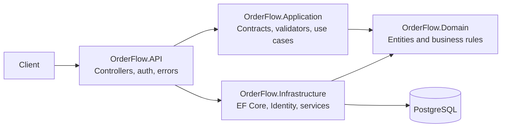

# OrderFlow

OrderFlow is a REST API for customer, catalog, stock, order, and sales operations for small and medium businesses. It uses .NET 10, ASP.NET Core Identity, JWT bearer authentication, EF Core, and PostgreSQL.

## Running Locally

**Windows 11**

1. Install Docker Desktop and launch it once.
2. Clone or extract this repository.
3. Double-click `RUNLOCALLY.bat`.
4. Open [http://localhost:8080/swagger](http://localhost:8080/swagger).

**Linux**

1. Install Docker Engine, Docker Compose v2, `curl`, and OpenSSL.
2. Clone this repository.
3. Run `chmod +x RUNLOCALLY.sh` once, then `./RUNLOCALLY.sh`.
4. Open [http://localhost:8080/swagger](http://localhost:8080/swagger).

RUNLOCALLY checks Docker and the selected ports, creates a private `.env` from `.env.example` when needed, generates random local secrets and a one-time administrator password, builds the API image, waits for PostgreSQL, applies EF Core migrations, waits for database-backed API health, and runs API smoke checks. Generated administrator credentials are saved in `.local-credentials.txt`; keep it private. Neither file is committed. No .NET SDK or PostgreSQL installation is needed for Docker startup.

The containers are the API and PostgreSQL. PostgreSQL data lives in the named `orderflow_postgres-data` volume. `STOPLOCALLY.bat` stops the services without removing that volume; `RUNLOCALLY.bat -Action Restart` restarts services and verifies that existing orders remain in the database. Use `RUNLOCALLY.bat -Action Status` to inspect state and `RUNLOCALLY.bat -Action Logs` to follow logs. On Linux, pass the same modes to `./RUNLOCALLY.sh`.

`TESTLOCALLY.bat` restores dependencies, builds Release, and runs the test suite. It uses the host .NET SDK when present, otherwise the official .NET 10 SDK container. Test output is saved under `TestResults/`. Tests currently use domain-level unit coverage and do not require or modify the development database.

To use different ports, edit `ORDERFLOW_API_PORT` or `POSTGRES_PORT` in `.env`. If a port is occupied, RUNLOCALLY reports the port and leaves existing services and data untouched. For local Docker Desktop installation, RUNLOCALLY offers the official `winget` package and proceeds only after explicit confirmation. If Docker Desktop needs a restart or manual first launch, the script explains that before exiting.

**Troubleshooting:** Start Docker Desktop and wait for its engine indicator before retrying. If the API image build fails, check internet access for NuGet and the .NET container image registry. For database/API startup details, run `RUNLOCALLY.bat -Action Logs`. Do not remove the named PostgreSQL volume unless you intentionally want to destroy local records.

The local environment does not require a GitHub account or a public repository.

## Features

- Customer and product CRUD with search, sorting, and bounded pagination.
- Unique customer email and product SKU constraints.
- JWT access tokens, Identity password hashing, and Admin / Employee roles.
- Server-priced multi-line orders with stock reservations and persisted status history.
- Validated status transitions: Pending → Confirmed → Processing → Shipped → Delivered; cancellation is allowed before shipment.
- Stock receipts and reservation/release/fulfillment ledger entries.
- Date-filtered sales totals, average order value, cancelled orders, and popular products.
- ProblemDetails error responses, request correlation through trace IDs, and structured Serilog request logs.

## Technology and architecture

- .NET 10 / ASP.NET Core Web API
- EF Core 10 and Npgsql 10 / PostgreSQL
- ASP.NET Core Identity and JWT bearer tokens
- FluentValidation, Serilog, Swagger / OpenAPI, xUnit
- Docker Compose



The API depends on Application and Infrastructure. Infrastructure implements application contracts and persists Domain entities. Domain contains no API or persistence dependencies.

## Database structure

```mermaid
erDiagram
  CUSTOMER ||--o{ ORDER : places
  ORDER ||--|{ ORDER_ITEM : contains
  PRODUCT ||--o{ ORDER_ITEM : priced_as
  ORDER ||--o{ ORDER_STATUS_HISTORY : records
  PRODUCT ||--o{ INVENTORY_TRANSACTION : moves
  CUSTOMER { uuid id PK; string name; string email UK }
  PRODUCT { uuid id PK; string sku UK; decimal price; int stockOnHand; int reservedStock }
  ORDER { uuid id PK; uuid customerId FK; string status; datetime createdAtUtc }
  ORDER_ITEM { uuid id PK; uuid orderId FK; uuid productId; int quantity; decimal unitPrice }
  ORDER_STATUS_HISTORY { uuid id PK; uuid orderId FK; string status; datetime changedAtUtc }
  INVENTORY_TRANSACTION { uuid id PK; uuid productId; string type; int quantity; datetime createdAtUtc }
```

Identity tables are supplied by ASP.NET Core Identity. The initial EF Core migration is applied at API startup. Schema changes should be added as reviewed migrations and committed with the source.

## API endpoints

| Method | Endpoint | Access |
|---|---|---|
| POST | `/api/auth/register` | Public; creates Employee |
| POST | `/api/auth/login` | Public |
| GET / POST | `/api/customers` | Authenticated / Authenticated |
| GET / PUT / DELETE | `/api/customers/{id}` | Authenticated / Authenticated / Admin |
| GET | `/api/products` | Authenticated |
| GET / POST / PUT / DELETE | `/api/products/{id}` and `/api/products` | Authenticated reads; Admin writes |
| GET | `/api/inventory/products/{productId}/transactions` | Admin or Employee |
| POST | `/api/inventory/transactions` | Admin or Employee; receipts only |
| GET / POST | `/api/orders` | Authenticated; list supports customer/status filters and pagination |
| GET | `/api/orders/{id}` | Authenticated |
| GET | `/api/orders/{id}/history` | Authenticated |
| PATCH | `/api/orders/{id}/status` | Authenticated |
| GET | `/api/analytics/overview?from=...&to=...` | Admin |

Swagger UI is available at `/swagger`.

## Local configuration

The API reads standard ASP.NET Core environment variables. Set a strong signing key of at least 32 bytes, and configure a PostgreSQL connection string:

```powershell
$env:ConnectionStrings__Default = 'Host=localhost;Port=5432;Database=orderflow;Username=orderflow;Password=<your-private-password>'
$env:Jwt__SigningKey = 'replace-with-a-random-secret-of-at-least-32-bytes'
$env:Jwt__Issuer = 'OrderFlow'
$env:Jwt__Audience = 'OrderFlow.Client'
```

To provision the first administrator, set `BootstrapAdmin__Email` and `BootstrapAdmin__Password` before startup. Public registration can only create Employee accounts. No signing key or bootstrap credentials are committed.

## Run with Docker Compose manually

Create a local `.env` file (do not commit it):

```dotenv
POSTGRES_PASSWORD=<your-private-database-password>
JWT_SIGNING_KEY=<a-random-secret-of-at-least-32-bytes>
BOOTSTRAP_ADMIN_EMAIL=admin@example.com
BOOTSTRAP_ADMIN_PASSWORD=<your-private-admin-password>
```

When running the API directly (without Compose), provide `BootstrapAdmin__Email` and `BootstrapAdmin__Password` as environment variables.

Then start the API and PostgreSQL. On first run, use RUNLOCALLY to generate secure credentials and run the health and API checks; direct Compose startup requires a fully populated `.env` file:

```bash
docker compose up --build
```

Compose waits for PostgreSQL's health check before starting the API. PostgreSQL data persists in the `orderflow_postgres-data` volume. Open `http://localhost:8080/swagger`.

For a local SDK run, start PostgreSQL with `docker compose up -d db`, set the environment variables above, then run:

```bash
dotnet run --project src/OrderFlow.API
```

## Example requests

Register an employee:

```http
POST /api/auth/register
Content-Type: application/json

{"email":"employee@example.com","password":"<your-private-password>","displayName":"Alex"}
```

Create a customer with a returned bearer token:

```http
POST /api/customers
Authorization: Bearer <access-token>
Content-Type: application/json

{"name":"Northwind Traders","email":"orders@northwind.example","phone":"+1-555-0100"}
```

Create an order; the submitted request contains product IDs and quantities only. The API snapshots current prices and reserves stock:

```http
POST /api/orders
Authorization: Bearer <access-token>
Content-Type: application/json

{"customerId":"<customer-guid>","items":[{"productId":"<product-guid>","quantity":2}]}
```

## Tests

```bash
dotnet test OrderFlow.slnx
```

Domain tests cover server-side totals, stock reservations, negative values, valid transitions, and rejected transitions. API integration tests and concurrency stress tests are not included yet.

## Repository layout

```text
src/OrderFlow.API/             HTTP endpoints, auth, middleware, configuration
src/OrderFlow.Application/     DTOs, contracts, validation
src/OrderFlow.Domain/          Entities and business rules
src/OrderFlow.Infrastructure/  EF Core, PostgreSQL, Identity, implementations
tests/OrderFlow.Tests/         Domain unit tests
```
