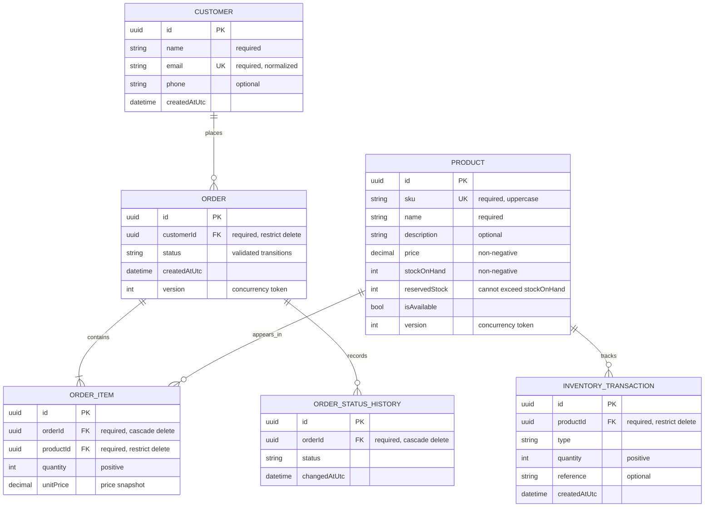
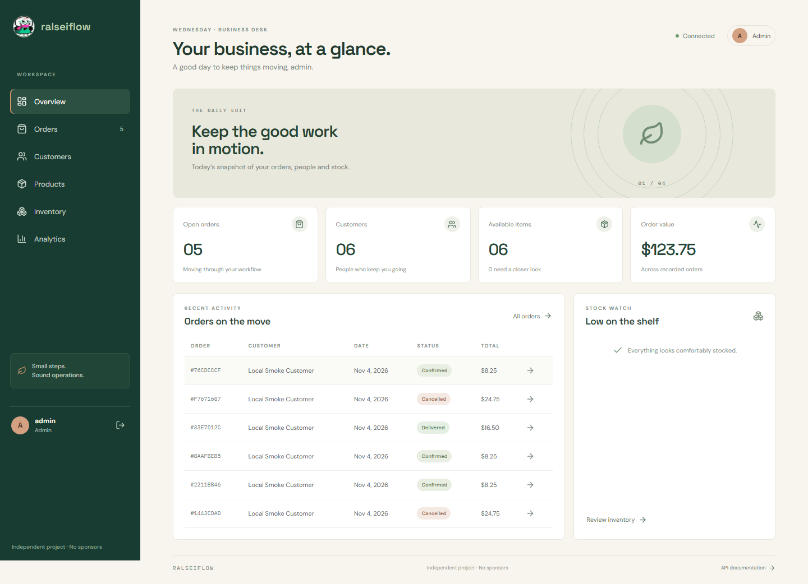
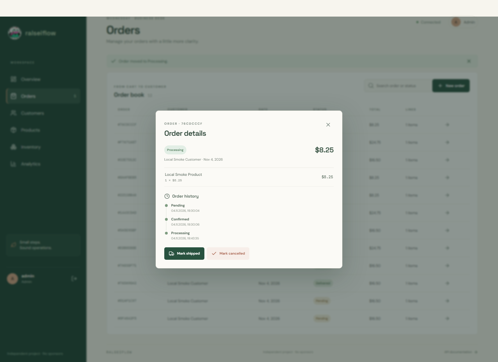
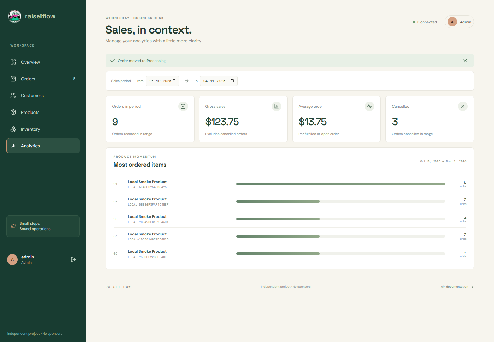

# RalseiFlow

**Orders, stock & business — in one place.** RalseiFlow is a small-business workspace for customers, products, inventory, order fulfillment, and sales reporting. Its React interface runs on an ASP.NET Core API backed by PostgreSQL.

## What it demonstrates

- Responsive React workspace with a live operations overview, role-aware navigation, inline order history, stock receipts, and date-filtered analytics.
- Employee registration and JWT authentication with Admin and Employee roles.
- Customer and product management with search, sorting, pagination, and uniqueness constraints.
- Server-side order pricing, stock reservation, validated status transitions, and persisted history.
- Inventory receipts, releases, fulfillment adjustments, and transaction history.
- Date-filtered sales analytics.
- PostgreSQL persistence, EF Core migrations, structured request logging, and ProblemDetails errors.

## Technology and architecture

.NET 10, ASP.NET Core, EF Core/Npgsql, PostgreSQL, ASP.NET Core Identity, JWT, FluentValidation, Serilog, Swagger/OpenAPI, Docker Compose, and xUnit.

The React and TypeScript frontend is served by the API at `/`. The API exposes controllers and authentication; Application defines contracts and validation; Domain owns business rules; Infrastructure implements persistence and services. Swagger is served at `/swagger`.

## Database structure



The diagram shows the application-owned business tables. ASP.NET Core Identity also creates its standard user, role, claim, login, token, and user-role tables. EF Core migrations define the deployed schema and its indexes.

## Run locally

Requirements: Docker Desktop on Windows, or Docker Engine and Compose on Linux.

**Recommended startup:** On Windows, run `RUNLOCALLY.bat`. On Linux, run `chmod +x RUNLOCALLY.sh` once, then `./RUNLOCALLY.sh`. Each script builds and starts the frontend, API, and PostgreSQL, waits for database readiness, and runs the configured startup checks; do not run a second `docker compose up` afterward. Open [RalseiFlow](http://localhost:8080/) or [Swagger](http://localhost:8080/swagger).

The scripts prepare a private `.env`, generate local credentials, apply migrations, and check API health. Administrator credentials are stored in `.local-credentials.txt`; keep it private. PostgreSQL data persists in `orderflow_postgres-data`. `STOPLOCALLY.bat` stops services without deleting the volume.

**Manual Compose alternative:** Create and populate `.env` using the variable names in `.env.example`, then run `docker compose up --build`. Compose starts the API and database; the API applies EF Core migrations during startup. This alternative does not run the startup scripts' readiness verification and API smoke checks. The current automatic migration and bootstrap setup is intended for local/demo use; production deployments should apply reviewed migrations through a controlled release process and use production-grade secret provisioning.

The API and database ports can be changed in `.env` using `ORDERFLOW_API_PORT` and `POSTGRES_PORT`. Do not commit `.env` or local credentials.

## Authentication and access

Registration and login are public; registration creates Employee accounts. Customer endpoints require authentication, with customer deletion restricted to Admin. Product reads require authentication; product creation, updates, and deletion require Admin. Inventory endpoints allow Admin and Employee. Order endpoints require authentication. Sales analytics requires Admin. These are the controller authorization rules; consult Swagger for operation schemas.

## API endpoints

| Method | Endpoint | Access |
|---|---|---|
| POST | `/api/auth/register` | Public |
| POST | `/api/auth/login` | Public |
| GET | `/api/customers` and `/api/customers/{id}` | Authenticated |
| POST | `/api/customers` | Authenticated |
| PUT | `/api/customers/{id}` | Authenticated |
| DELETE | `/api/customers/{id}` | Admin |
| GET | `/api/products` and `/api/products/{id}` | Authenticated |
| POST | `/api/products` | Admin |
| PUT | `/api/products/{id}` | Admin |
| DELETE | `/api/products/{id}` | Admin |
| GET | `/api/inventory/products/{productId}/transactions` | Admin or Employee |
| POST | `/api/inventory/transactions` | Admin or Employee |
| GET | `/api/orders` | Authenticated |
| POST | `/api/orders` | Authenticated |
| GET | `/api/orders/{id}` and `/api/orders/{id}/history` | Authenticated |
| PATCH | `/api/orders/{id}/status` | Authenticated |
| GET | `/api/analytics/overview` | Admin |

## API example

Register an Employee, then log in at `POST /api/auth/login` and use the returned access token for authorized calls. Public registration creates Employee accounts; administrator provisioning uses bootstrap configuration.

Create an order with a customer and product GUIDs:

```http
POST /api/orders
Authorization: Bearer <access-token>
Content-Type: application/json

{"customerId":"<customer-guid>","items":[{"productId":"<product-guid>","quantity":2}]}
```

The API obtains prices from stored product records and reserves available stock. See Swagger for request/response schemas and the full endpoint list.

## Verification

Run `TESTLOCALLY.bat` on Windows or `./RUNLOCALLY.sh Test` on Linux. The test project currently provides domain and validator unit tests; the local startup smoke workflow exercises API and database workflows. Dedicated automated API integration and concurrency stress suites are not included.

Verified for this revision:

- `dotnet build OrderFlow.slnx --configuration Release --no-restore` — passed with 0 warnings and 0 errors.
- `dotnet test OrderFlow.slnx --configuration Release --no-build` — 13 passed, 0 failed.
- `npm ci` and `npm run build` — passed; npm reported 0 vulnerabilities.
- `docker compose build api` — passed, including the frontend production build.
- Docker PostgreSQL and API containers reported healthy; `/health` returned `Healthy`, and `/swagger/v1/swagger.json` reported `RalseiFlow API`.
- `RUNLOCALLY.ps1 -Action Start` smoke checks passed for login/registration, customer/product creation, stock receipt, order pricing and reservations, status changes, cancellation release, history, and analytics.

The automated suite is domain-level unit coverage; the local Compose smoke workflow covers the main authenticated API/database paths. Dedicated load and concurrency stress suites are not included.

## Limitations

This is a portfolio implementation, not a production deployment. Automated integration and load testing are limited; operational hardening for a public production service is outside the project scope. No commercial customers or production usage are claimed.

## Project structure

`src/OrderFlow.API` hosts HTTP endpoints; `Application` contains contracts and validation; `Domain` contains entities and rules; `Infrastructure` contains EF Core and service implementations; `tests/OrderFlow.Tests` contains automated tests.

More context: [Portfolio case study](docs/PORTFOLIO.md) · [Published repository](https://github.com/marcel322gg-png/OrderFlow).

## Screenshots

[Browse the screenshot gallery](OrderFlow-Screenshots/index.html)







[Swagger API overview](OrderFlow-Screenshots/13-swagger-ralseiflow.png) · [Full order details](OrderFlow-Screenshots/08-order-details-history.png) · [Docker runtime](OrderFlow-Screenshots/11-docker-runtime.png) · [Live database schema](OrderFlow-Screenshots/12-postgresql-schema.png)
